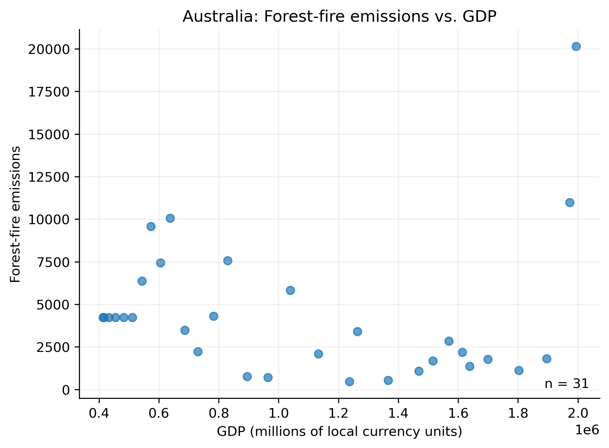

# tdd

```
curl -L "https://docs.google.com/uc?export=download&id=1AsXP_OGs1O_TDeXiZjk3fYV1SrG4vwXF" -o data/Agrofood_co2_emission.csv
curl -L "https://docs.google.com/uc?export=download&id=19YEPysdnK7VCXuAe9Og9pwYkNT5CbQzr" -o data/IMF_GDP.csv
```

In the presentation, I investigated the relationship between GDP and emission due to forest fires. I took country-specific annual emissions and GDP data and plotted them to investigate potential trends. I found that some countries did not have enough information about either emissions or GDP data to draw useful conclusions. Many countries, on the other hand, showed either no trend with emissions data or showed exponentially decreasing emissions with GDP. One such plot is shown here for Australia.\
\
\
\
Additionally, I noticed a trend where the more recent years have greater emissions regardless of GDP. These plots and results were generated using the framework in the following script using Denmark as an example:\
\
python src/scatter.py --co2_file test/data/test_co2.csv --gdp_file test/data/test_gdp.csv --country "Denmark" --output figures/denmark.png\
\
## Snakemake Workflow

The original analysis has been adapted into a Snakemake workflow to automate the generation of country-specific forest-fire emissions versus GDP scatterplots.

The `Snakefile` defines the input datasets, expected outputs, execution commands, and software environment. Variables and wildcards allow the same plotting rule to be applied to multiple countries without manually executing each analysis.

### Execution

To inspect the workflow without executing commands:

```bash
snakemake --cores 1 --dryrun --printshellcmds
```

To execute the analysis using the specified Conda environment:

```bash
snakemake --cores 1 --sdm conda
```

To generate a visualization of the dependency graph:

```bash
snakemake --dag | dot -Tpng > dag.png
```

The resulting plots are saved to `figures/workflow/`.

### Testing Scientific Workflows

Testing scientific workflows is important for verifying that analyses are reproducible and that individual processing steps execute correctly. Several approaches could be used to test this workflow:

1. **Dependency testing:** Use Snakemake's dry-run functionality to confirm that the correct input files, rules, and expected outputs are identified before execution.
2. **Output validation:** Execute the workflow with the existing test datasets and verify that the expected plots are generated. Confirm that the images are nonempty and can be opened.
3. **Incremental execution:** Run the workflow multiple times to confirm that completed jobs are skipped when their outputs are up to date. Removing one output should trigger regeneration of only that output.
4. **Failure testing:** Test the workflow with missing input files or invalid country names to verify that errors are identified and reported appropriately.
5. **Continuous integration:** Integrate the Snakemake workflow into GitHub Actions so that workflow execution can be checked automatically after code changes.

These approaches would complement the repository's existing unit and functional tests. Unit tests assess individual functions, functional tests examine program behavior, and workflow tests verify that the complete sequence of operations produces the expected results.